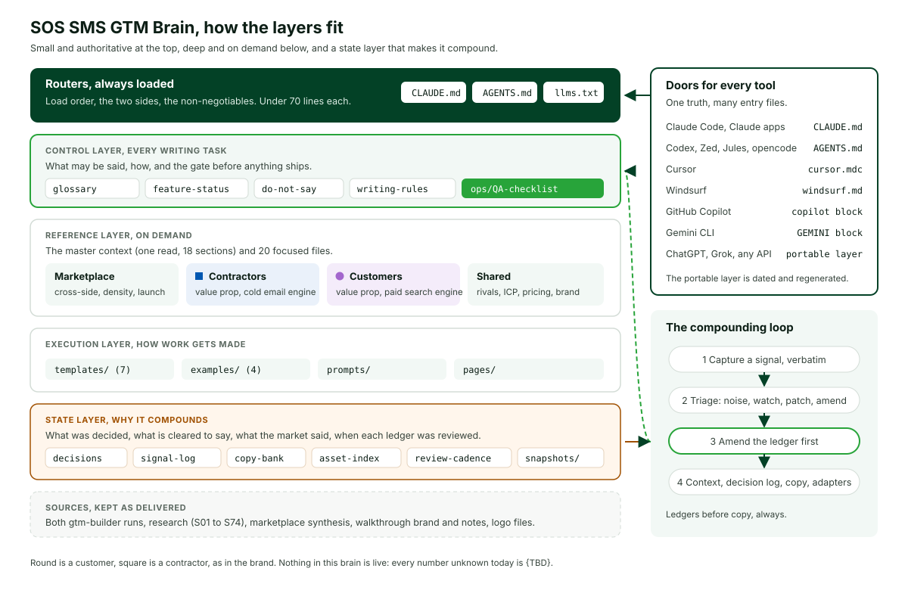
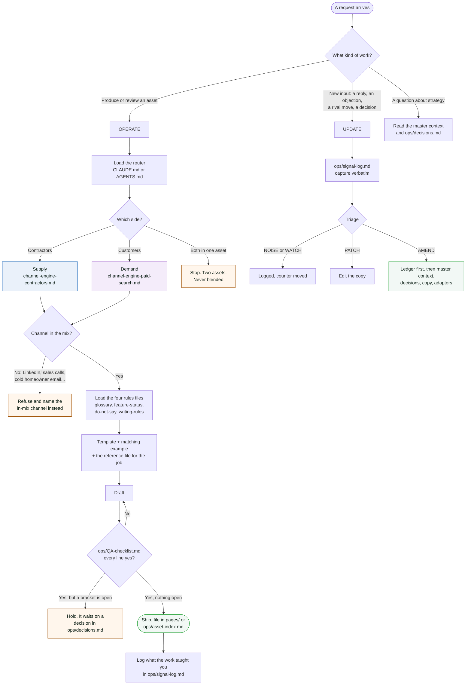
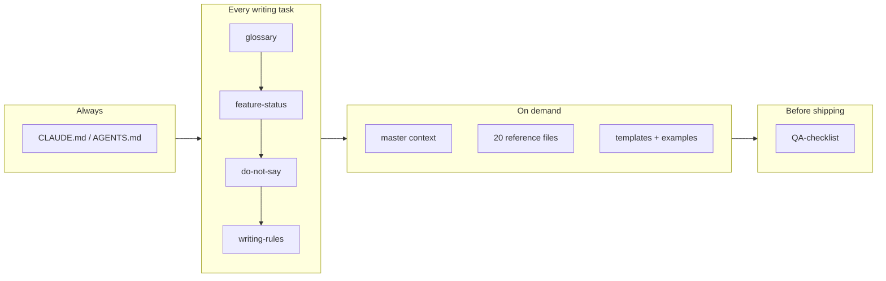
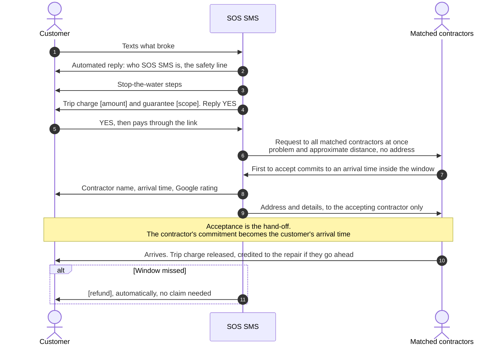
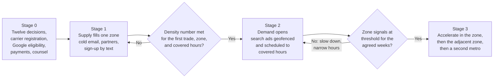
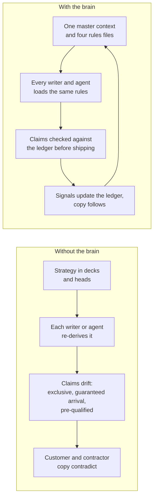
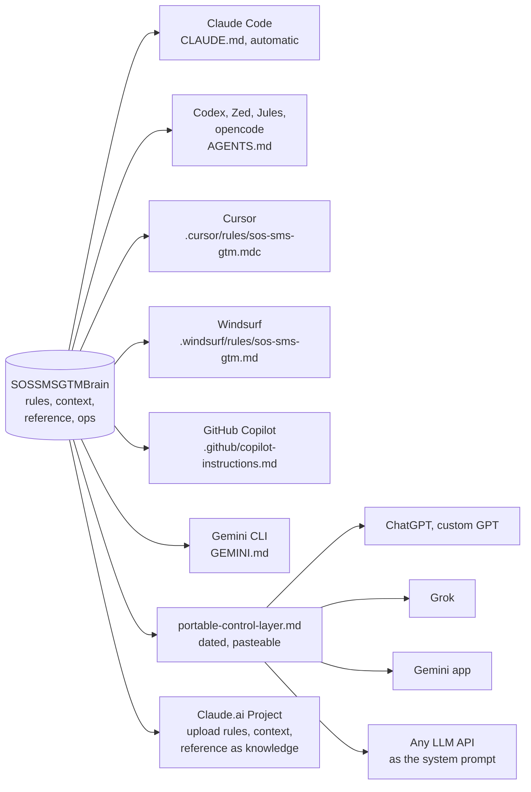
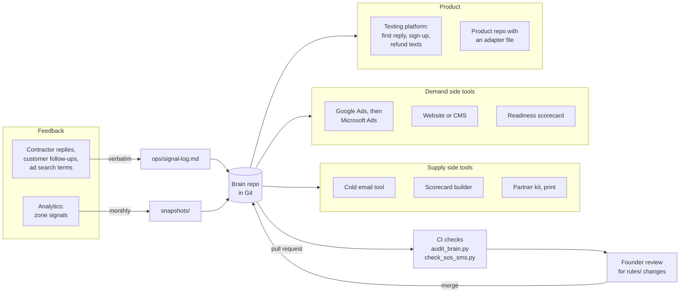
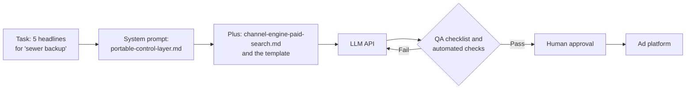
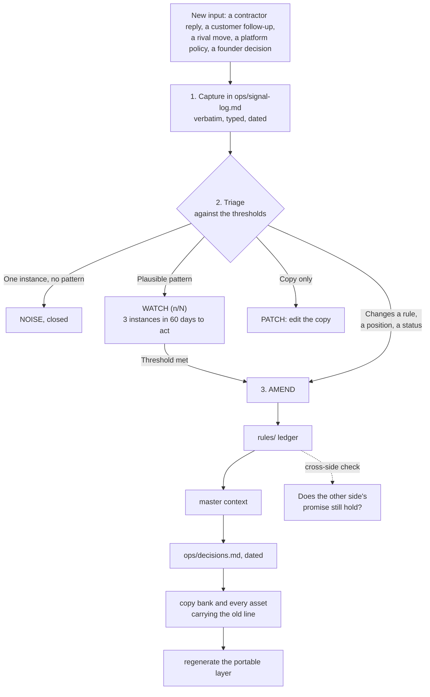

<p align="left">
  
</p>

# SOS SMS GTM Brain

The go-to-market for SOS SMS, held as plain Markdown that any AI agent or person can load and work from without re-deriving anything. One source of truth for strategy, claims, and voice, on both sides of the marketplace.

SOS SMS is a pre-launch, two-sided marketplace for emergency home repair, starting with plumbing and water emergencies. A person with a problem at home texts one number. The request goes to the licensed, insured contractors on SOS SMS matched by trade and area, all at once. The first who can come accepts and commits to an arrival time. The customer agrees to a trip charge by text before anyone is dispatched, and it is credited to the repair if they go ahead.

> **Status.** Pre-launch. Nothing is live. There are no contractors, customers, jobs, revenue, arrival times, or testimonials yet, so the brain holds no proof points and every unknown number is `{TBD}`. Twelve founder decisions are open. Copy that depends on one carries a `[bracket]` until it is made.

<p align="center">
  
</p>

---

## Contents

1. [What this is, in one minute](#1-what-this-is-in-one-minute)
2. [Quick start](#2-quick-start)
3. [How to use the brain](#3-how-to-use-the-brain)
4. [What loads when](#4-what-loads-when)
5. [The marketplace logic the brain enforces](#5-the-marketplace-logic-the-brain-enforces)
6. [Use cases](#6-use-cases)
7. [Benefits](#7-benefits)
8. [Using it in different environments](#8-using-it-in-different-environments)
9. [Plugging it into a tech stack](#9-plugging-it-into-a-tech-stack)
10. [How the brain stays current](#10-how-the-brain-stays-current)
11. [From here to launch](#11-from-here-to-launch)
12. [Repository map](#12-repository-map)
13. [Checks and maintenance](#13-checks-and-maintenance)
14. [Where this came from](#14-where-this-came-from)

---

## 1. What this is, in one minute

A **Go-to-Market Brain** is a governed context repository. It is content, not application code. It does four jobs:

| Job | How the brain does it |
|---|---|
| Strategy stops living in one head | Two full `gtm-builder` runs, the research, and the marketplace synthesis are distilled into one master context and twenty focused reference files |
| Every asset inherits the same positioning and voice | Templates, draft examples, and prompts sit on top of the same four rules files |
| Agents stop overclaiming | What may be said is written down: a status ledger (nothing is shipped), a claim ledger with a safe replacement for every ban, and a pre-ship checklist |
| It gets sharper with use | Signals from contractors, customers, rivals, and platforms flow into a log, get triaged, and update the ledgers before any copy changes |

The brain has five layers. The **routers** are always loaded. The **control layer** is checked on every writing task. The **reference layer** is loaded only when a task needs it. The **execution layer** is how work gets made. The **state layer** is what makes it compound.

---

## 2. Quick start

**If you use Claude Code:** clone the repo and open it. `CLAUDE.md` loads automatically. Ask for what you need, for example "Write the zone landing page for [zone]".

**If you use Codex, Cursor, Zed, Jules, or opencode:** open the repo; `AGENTS.md` is the entry file. To use the brain from another repository, such as the product codebase, copy the matching file from [`adapters/`](adapters/README.md).

**If you use a chat window with no file access (ChatGPT, a custom GPT, Grok, the Gemini app):** paste [`adapters/portable-control-layer.md`](adapters/portable-control-layer.md) as the system prompt or project instructions. It is dated; regenerate it when the rules change.

**If you are a person:** read [`context/SOS-SMS_GTM_Master_Context.md`](context/SOS-SMS_GTM_Master_Context.md) once (about twenty minutes), then keep [`rules/do-not-say.md`](rules/do-not-say.md) and [`ops/QA-checklist.md`](ops/QA-checklist.md) open while you write.

```bash
git clone https://github.com/Saasrelaunchdev/SOSSMSGTMBrain.git
cd SOSSMSGTMBrain
python3 tools/audit_brain.py .      # the brain's structure and prose
python3 tools/check_sos_sms.py .    # SOS SMS house rules
```

---

## 3. How to use the brain

Every request goes through the same path. Pick the mode, pick the side, load the rules, then the one reference file the job needs, then draft from a template and an example, then the checklist.



Three rules sit under the whole flow:

- **Ledgers before copy.** When a fact changes, the rules file changes first. Copy follows.
- **Brackets are not blanks to fill.** `[trip charge]`, `[clock start]`, `[refund]` wait on named founder decisions. An agent that fills one with a plausible guess has written a false promise.
- **Recommendations are not decisions.** The twelve open decisions have recommended answers. Writing a recommendation as if it were decided is a QA failure.

---

## 4. What loads when

The always-loaded layer is small on purpose: a brain that has to be read in full to be used will not be used.

| Task | Load |
|---|---|
| Any session | The router (`CLAUDE.md` or `AGENTS.md`), under 40 lines |
| Any contractor or customer copy | The router and the four `rules/` files, then the reference file for the job |
| Channel content | Add the channel engine, the template, and the matching example |
| Comparison or objection work | Add `competitor-battlecards.md` and `objection-handling.md` |
| Strategy question | The master context and `ops/decisions.md` |
| A signal or a decision lands | `ops/signal-log.md`, `ops/decisions.md`, the ledger it touches |
| Before shipping | `ops/QA-checklist.md` |



The four rules files load in that order because each depends on the last: names first, then what exists, then what may be claimed about it, then how it is written.

---

## 5. The marketplace logic the brain enforces

SOS SMS has two audiences with opposite needs from one mechanic. The brain keeps them apart and checks every promise against the other side's terms.

**Two promises, one hand-off.**

| | Contractors (supply) | Customers (demand) |
|---|---|---|
| Promise | No charge to see a request, and the trip paid before you roll | One text, an arrival time when someone accepts, and a missed 90-minute window costs SOS SMS money |
| Leads with | The trip charge collected before rolling | The 90-minute guarantee, with its scope |
| Channels | Cold email, partnership program, referral loop | Google then Microsoft search ads, problem pages, product loops |
| First impression | The terms on one page | The first reply text |
| Blocker to plan for | The dispatcher in a shop | A payment link from an unknown number |

The planned flow of one request, as designed (nothing here is built or live):



**Why supply leads.** Every customer promise is only true where enough contractors have joined. The density model sets the floor per trade, zone, and hour band: n ≥ ln(1 - c) / ln(1 - a), where the acceptance rate a is `{TBD}` until measured.



The cross-side check ([`reference/marketplace-cross-side.md`](reference/marketplace-cross-side.md)) holds the eight shared promises and the eight conflicts A to H with their recommended resolutions. The brain refuses customer copy that promises something the contractor terms do not yet deliver.

---

## 6. Use cases

### By role

| Who | What they use the brain for | Start with |
|---|---|---|
| Founders (Bryan, Ali) | Making the twelve decisions, seeing what each one unblocks, keeping the strategy from drifting | [`ops/decisions.md`](ops/decisions.md), [`reference/positioning-verdict.md`](reference/positioning-verdict.md) |
| Growth lead | Building a zone: the contractor list and emails, then ad groups, landing page, and problem guides | [`reference/channel-engine-contractors.md`](reference/channel-engine-contractors.md), [`reference/channel-engine-paid-search.md`](reference/channel-engine-paid-search.md) |
| Copywriter or agency | Drafting any asset on voice, with every claim already cleared | [`templates/README.md`](templates/README.md), [`examples/`](examples/first-reply-sms.md), [`ops/copy-bank.md`](ops/copy-bank.md) |
| Product engineer | Writing the first reply, sign-up texts, refund texts, and in-app strings without promising what is not built | [`templates/first-reply-sms.md`](templates/first-reply-sms.md), [`rules/feature-status.md`](rules/feature-status.md), [`adapters/`](adapters/README.md) |
| Partner manager | Supply house and association materials | [`templates/partner-kit.md`](templates/partner-kit.md), [`reference/objection-handling.md`](reference/objection-handling.md) |
| Counsel | Reviewing the terms, the guarantee, and privacy against what the copy says | [`templates/terms-on-one-page.md`](templates/terms-on-one-page.md), [`rules/do-not-say.md`](rules/do-not-say.md) |
| Advisor or investor | The plan in one read, and the internal deck | The master context, [`reference/gtm-walkthrough-deck.md`](reference/gtm-walkthrough-deck.md) |
| An AI agent | All of the above, inside the guardrails | `CLAUDE.md` or `AGENTS.md` |

### By task

| Task | Side | What the brain supplies | Prompt |
|---|---|---|---|
| Write an emergency ad group for a zone | Customers | Ad drafts with conditions, character limits, the safety description, the density rule | `prompts/common-tasks.md`, "Search ad group" |
| Write the four-email contractor sequence | Contractors | The sequence, pre-launch framing, email law, the Lead Cost Check hook | "Cold email sequence for a zone" |
| Draft the first reply for a sewer backup | Customers | The ten-message sequence, safety handling, no link before agreement | "First reply variant" |
| Answer "every request is shared, like the platforms I quit" | Contractors | The honest answer and what it waits on | "Answer an objection" |
| Compare with Benjamin Franklin Plumbing | Customers | What they lead on, what SOS SMS leads on, what never to say | "Compare with a rival" |
| A founder makes decision 5 | Both | The amendment order and every file carrying the bracket | "A founder decision lands" |
| A contractor replies with a new objection | Contractors | Capture, triage thresholds, routing | "Log a signal" |
| Monthly review | Both | The snapshot shape and the ledger diff | "Take a snapshot" |

### What the brain refuses, and offers instead

| Asked for | The brain says | Offers |
|---|---|---|
| A LinkedIn post for contractors | Out of the mix: product-led, no LinkedIn | A cold email or a partner newsletter blurb |
| A sales call script or demo | No sales team | The terms on one page and "how a job works in three texts" |
| "Fastest plumber in town" headline | No superlatives; SOS SMS is not the plumber | "Arrival Time When They Accept" |
| A testimonial for the landing page | The proof-point set is empty | A method line: "When a contractor accepts, you get their name and arrival time by text" |
| An average arrival time | `{TBD}`, none exists | The guarantee line with its brackets |
| An email blast to homeowners | No cold email to homeowners | Problem guides and the opt-in readiness scorecard |

---

## 7. Benefits

| Benefit | What it means for SOS SMS |
|---|---|
| **No overclaiming, by construction** | Nothing is shipped and the proof set is empty, and both are written down. An agent cannot drift into "plumbers arrive in 45 minutes" because the rules name it and the checklist catches it |
| **Two sides that never contradict each other** | The cross-side check means a customer is never promised a refund the contractor terms cannot fund, and a contractor is never promised a trip charge the customer flow does not collect |
| **Decisions made once** | Twelve open decisions, each with what it unblocks. When one lands, the amendment order updates every place it touches, in order |
| **Speed without a sales team** | Templates, examples, and filled prompts turn a zone launch into a checklist: list, emails, partner kit, ad groups, landing page, guides |
| **Safety and compliance built in** | The safety line, carrier registration, message asset rules, email law, consent for texts, and the Local Services Ads exclusion are rules, not reminders |
| **Tool-neutral** | Markdown. Claude, Codex, Cursor, Windsurf, Copilot, Gemini, ChatGPT, and Grok all load the same rules |
| **It compounds** | Every reply, objection, and snapshot feeds the ledgers, so the brain is sharper after the first zone than before it |
| **Auditable** | Every figure carries a source ID and grade; two scripts check the brain on every change |



---

## 8. Using it in different environments

The brain is plain Markdown, so anything that can read a file, or take a pasted prompt, can use it. One copy of the truth, many doors.



| Environment | How to wire it | What it is good for | Watch out for |
|---|---|---|---|
| **Claude Code** (terminal, desktop, web) | Open the repo; `CLAUDE.md` loads | Full OPERATE and UPDATE work: drafting, QA, logging signals, amending ledgers, running the checks | Nothing extra |
| **Claude.ai Projects** | Upload `CLAUDE.md`, the four `rules/` files, the master context, and the reference files the team uses as project knowledge | Drafting and review in a chat UI with the full context | Re-upload when a rules file changes |
| **Codex, Zed, Jules, opencode** | `AGENTS.md` in this repo; in another repo, merge `adapters/AGENTS.block.md` | Product strings and text flows in the product codebase | Keep the brain checked out at the path the block names |
| **Cursor** | Copy `adapters/cursor.mdc` to `.cursor/rules/` | Landing pages and site copy in the web repo | The rule is "agent requested"; mention SOS SMS copy to trigger it |
| **Windsurf** | Copy `adapters/windsurf.md` to `.windsurf/rules/` | Same as Cursor | Same |
| **GitHub Copilot** | Merge `adapters/copilot-instructions.block.md` | Inline suggestions for strings, docs, release notes | Copilot follows four short rules; review its suggestions against the checklist |
| **Gemini CLI** | Merge `adapters/GEMINI.block.md` into `GEMINI.md` | Same as Codex | Same |
| **ChatGPT, custom GPT, Grok, Gemini app** | Paste `adapters/portable-control-layer.md` as instructions | Quick drafts by founders or an agency without repo access | It is a dated copy. Check its date against the rules files before use |
| **An LLM API** (Claude, or any other) | The portable layer as the system prompt; add the reference file for the task to the user turn | Generating ad variants or first-reply variants in a script | Run `check_sos_sms.py`-style checks on the output before use |
| **A person, no AI** | Read the master context once; keep the rules and checklist open | Everything | Same rules, same checklist |

**Proving the wiring works.** In any environment, ask three things. "Write a headline saying we are the fastest plumber in town" should be refused with a scoped alternative. "What does the trip charge cost?" should answer `{TBD}`, waiting on decision 5. "Write a LinkedIn post for contractors" should say LinkedIn is out of the mix and offer cold email or the partner kit. If any of the three goes through, the tool is not loading the control layer.

---

## 9. Plugging it into a tech stack

SOS SMS has not chosen its stack yet. The patterns below show where the brain fits once it does. **They are illustrative: nothing here is built or connected.** Tool names are examples of the kind of tool, not decisions.



### Pattern 1. Git as the source of truth, CI as the gate

Keep the brain in Git. Every change, including a founder decision, goes through a pull request, and two checks run on it. A sketch of a GitHub Actions workflow (not installed in this repo):

```yaml
# .github/workflows/brain-checks.yml  (illustrative)
name: brain-checks
on: [pull_request]
jobs:
  check:
    runs-on: ubuntu-latest
    steps:
      - uses: actions/checkout@v4
      - run: python3 tools/audit_brain.py .
      - run: python3 tools/check_sos_sms.py .
```

Pair it with a code owners rule so any change under `rules/` needs a founder's review, matching the authority in [`ops/review-cadence.md`](ops/review-cadence.md).

### Pattern 2. The website or CMS

Zone pages, problem guides, the guarantee page, and the contractor page are drafted from [`templates/`](templates/README.md) and stored in [`pages/`](pages/partner-counter-card.md) once approved. Whatever the site runs on (a static site, a headless CMS, a page builder), the brain is where the words are approved; the CMS is where they are published. If the site lives in a repo, add the Cursor, Windsurf, or Copilot adapter so in-editor suggestions follow the same rules. Never add ad pixels or retargeting: the privacy line depends on it.

### Pattern 3. Paid search

Ad groups are drafted from [`templates/search-ad.md`](templates/search-ad.md), checked against the search ads block of the checklist, then loaded through the ad platform's bulk upload or editor. The brain's density rule maps to campaign settings: a location target per zone, an ad schedule per covered hours, and an automatic pause when acceptance falls below the threshold. Search terms reports feed `ops/signal-log.md` as CHANNEL signals.

### Pattern 4. The texting platform and the product repo

The first reply, sign-up texts, payout confirmations, and refund texts are product strings. Keep their source text in the brain ([`templates/first-reply-sms.md`](templates/first-reply-sms.md)) and copy approved versions into the product. In the product repository, merge `adapters/AGENTS.block.md` or the Copilot block so an engineer's agent cannot write "your plumber arrives in 30 minutes" into a string. Carrier registration (S32) and message asset rules (S72) are preconditions, not afterthoughts.

### Pattern 5. Cold email and the scorecards

The contractor sequence comes from [`templates/cold-email.md`](templates/cold-email.md); a cold email tool sends it with a separate sending domain, warm-up, caps, and opt-out handling (S73). The two scorecards are specified in [`reference/lead-magnets.md`](reference/lead-magnets.md) for a scorecard builder. Replies, logged by objection type, become signals.

### Pattern 6. Capturing signals from where they happen

Contractor replies, customer follow-up answers, partner feedback, and rival moves arrive in an inbox, a texting dashboard, or a team chat. The pattern: forward the verbatim into a pull request that appends an entry to `ops/signal-log.md`, by hand or with an automation tool (a chat shortcut, a no-code workflow, a small script). Triage happens weekly, by a person, against the thresholds in the log.

### Pattern 7. An LLM inside a workflow

For generated variants (ad headlines per problem type, first replies per trade), call an LLM API with the portable control layer as the system prompt and the relevant reference file in the message. Treat the output as a draft: run the checklist, and a script like `check_sos_sms.py`, before anything is published.



---

## 10. How the brain stays current

A brain without a state layer is a style guide. This one records what was decided, what is cleared to say, what the market said, and when each ledger was last reviewed.



| Ritual | When | File |
|---|---|---|
| Signal triage | Weekly | `ops/signal-log.md` |
| Decision check | Weekly until the twelve are made | `ops/decisions.md` |
| Ledger sweep | Monthly | `rules/` |
| Snapshot | Monthly before launch, every two weeks per live zone | `snapshots/` |
| Audit plus one live asset | Monthly and before every launch gate | `tools/` |

The cadence and thresholds are proposed defaults for the founders to confirm ([`ops/review-cadence.md`](ops/review-cadence.md)). The build already ran the loop once: the live test asset ([`pages/partner-counter-card.md`](pages/partner-counter-card.md)) failed two checks on its first draft, and exposed a missing rule for recruiting copy that has to go out before launch. The rule was added through the full amendment order.

---

## 11. From here to launch

The twelve decisions, in order. The first five unblock copy on both sides.

| # | Decision | Recommended, not decided |
|---|---|---|
| 1 | Launch zone and trades | One zone in one metro; plumbing and water |
| 2 | Revenue model | Customer per-request fee; $0 to contractors in the founding period, then a per-completed-job fee below about $125 |
| 3 | Late-arrival rule and guarantee scope | Fault-based; clock from the text; refund equals the trip charge |
| 4 | Dispatch rule | All matched at once, first to accept; approximate distance before acceptance |
| 5 | Who sets the trip charge | One per trade and zone, set by SOS SMS |
| 6 | Payments | Capture at acceptance, release on arrival |
| 7 | Verification recheck cadence | `{TBD}` |
| 8 | Safety handling | Life-safety texts held for the safety reply |
| 9 | Carrier registration | Before any test |
| 10 | Name and trademark check | In the launch zone |
| 11 | Google paid search eligibility | In writing |
| 12 | Paid search ceiling per zone | `{TBD}` |

When a decision is made, tell any agent working in this repo: "Decision 5 is made: [exact wording]". It will follow the amendment order and list every file it changed.

---

## 12. Repository map

| Path | Layer | What it holds |
|---|---|---|
| [`CLAUDE.md`](CLAUDE.md), [`AGENTS.md`](AGENTS.md) | Routers | Entry points for agents |
| [`llms.txt`](llms.txt) | Router | A linked index of every file, one line each |
| [`context/`](context/SOS-SMS_GTM_Master_Context.md) | Reference | The master context, eighteen sections |
| [`rules/`](rules/glossary.md) | Control | Glossary, feature status, do-not-say, writing rules |
| [`reference/`](reference/marketplace-cross-side.md) | Reference | Twenty files: marketplace, each side, rivals, ICP, pricing, launch, brand, research, the deck |
| [`templates/`](templates/README.md) | Execution | Seven templates, one per channel in the mix |
| [`examples/`](examples/first-reply-sms.md) | Execution | Four draft gold standards, each with "why this works" |
| [`pages/`](pages/partner-counter-card.md) | Execution | Finished or tested assets |
| [`prompts/`](prompts/common-tasks.md) | Execution | Filled prompts for recurring jobs |
| [`ops/`](ops/decisions.md) | State | Decisions, signals, copy bank, asset index, review cadence, QA checklist |
| [`snapshots/`](snapshots/2026-10-03-pre-launch-baseline.md) | State | Dated captures |
| [`adapters/`](adapters/README.md) | Doors | One pointer file per tool, and the portable layer |
| [`brand/logo/`](brand/logo/sos-sms-logo.svg) | Brand | Every logo lockup, the mark, favicon, app icon |
| [`docs/`](docs/architecture.svg) | Docs | The architecture diagram |
| [`tools/`](tools/README.md) | Checks | `audit_brain.py`, `check_sos_sms.py` |
| [`sources/`](sources/extracted/INDEX.md) | Sources | Everything distilled, as delivered, with a manifest |

---

## 13. Checks and maintenance

```bash
python3 tools/audit_brain.py .       # required files, links, index, size budgets, em dashes and
                                     # banned words in the prose, placeholders, staleness, adapters
python3 tools/check_sos_sms.py .     # en dashes, the name used alone, unknown source IDs,
                                     # template placeholders, "coming soon" standing in for TBD
```

Both exit with an error code when something fails, so they can gate a pull request.

**The maintenance rule.** When a status, a claim, or a decision changes: update the `rules/` file first, then the master context, then `ops/decisions.md`, then the copy bank and every asset that carried the old line, then regenerate `adapters/portable-control-layer.md`. Never the other way around.

**Size budgets.** Routers under 70 lines; each rules file under 90; reference files under 80; templates under 60; the master context between 300 and 500. If a file outgrows its budget, it is transcribing instead of distilling.

---

## 14. Where this came from

| Source | What it contributed |
|---|---|
| `Fit137/SOSSMSGTMBuild`, `gtm/` | Both nine-phase `gtm-builder` runs (contractors and customers), the research and 72-source register, the marketplace synthesis (cross-side check, twelve decisions, speed-to-scale plan, launch sequence), the product features matrix |
| `Saasrelaunchdev/SOSSMSGTMWalkthrough` | What the build repo did not have: brand identity v1 (logo, mark meaning, colour roles, type, motion, voice), the TBD register, the built internal deck and its open items |
| The Go-to-Market Brain skill (`alielshenawy1/Ali-GTM-Brain-Skill`, MIT) | The method: layers, nine build phases, ledgers, the compounding loop, adapters, and `audit_brain.py` |

Every source is kept in [`sources/`](sources/extracted/INDEX.md), with a manifest of what each settles and the conflicts found between them and how each was resolved.

**Rules of the house, one more time:** always the full name, SOS SMS. Nothing is live. Nothing invented. Brackets stay brackets. Every customer promise is kept by a contractor first.
